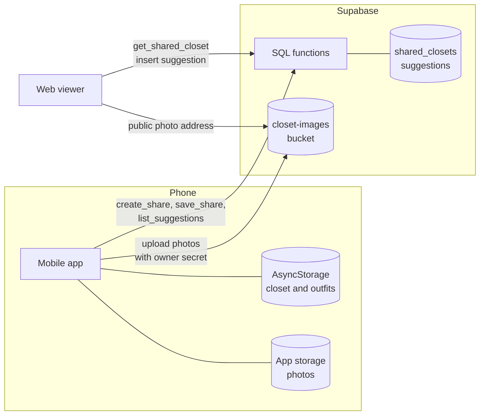

# Architecture

This document describes the parts of OOTD, how they connect, and where each part is in the code. Read it before a change that crosses two parts, for example a change to the shared data.

## Overview

OOTD has three parts:

1. **The mobile app** (React Native and Expo). It keeps all of the closet data on the device. It works without an account and without a network connection.
2. **The share backend** (Supabase). It holds only the data of the closets that the owner shares, and the outfit suggestions from friends.
3. **The web viewer** (React and Vite, hosted on Vercel). A friend opens a share link in a browser, picks items, and sends an outfit suggestion.

Only the share feature uses the network. Everything else in the app is local.

## Mobile app

### Navigation

`App.js` holds a bottom tab navigator with five tabs. Each tab has its own native stack, so a screen such as Item Details opens on top of the tab that opened it.

| Tab | First screen | Other screens in the stack |
| --- | --- | --- |
| Home | `HomeScreen` | Suggestions, Item Details, Outfit Builder |
| Closet | `ClosetScreen` | Item Details, Outfit Builder, Archived, Vacation |
| Calendar | `CalendarScreen` | Item Details, Outfit Builder, Outfit History, Favorites |
| Stats | `StatsScreen` | Item Details |
| Settings | `SettingsScreen` | none |

Each screen is one file in `src/screens/`. `src/components/` holds the parts that more than one screen uses.

Two components stay mounted for the full life of the app:

- `ShareSheet` sends a closet to Supabase. The sheet can close while the upload continues.
- `PhotoRepairGate` finds photo files that are missing and puts them back (see [Photos](#photos)).

### State

`src/store/useStore.ts` is a zustand store. The `persist` middleware saves it to AsyncStorage under the key `ootd-storage`. On load, the saved state is merged with the defaults, so a new field gets its default value.

The two main records are:

- **`ClothingItem`**: name, category (`hierarchyCategory`), sub-category, brand, colour, size, price, season, location, photo, and `archived`. Each item has a stable `itemNumber` (`#1`, `#2`, ...). Imports and the outfit history use this number.
- **`Outfit`**: the date worn, the item ids, and an optional name, note and favorite mark. An outfit with a later date is a planned outfit.

The store also keeps the share state: the link token, the owner secret, the vacation link, and the fingerprints of the photos that were already uploaded.

Two small stores do not persist: `useShare.ts` (whether the share sheet is open) and `useToast.ts` (short messages on screen). A link that is half sent must not come back after a restart.

### Outfit rules

`src/utils/outfitLogic.ts` holds the rules of the outfit builder:

- **Base of an outfit.** The tops and the bottoms. A jacket, or a second top, makes a layer.
- **Grey-out.** When the user picks tops, each bottom that was worn with all of those tops turns grey. Bottoms work the same way. Shoes, jackets and other items never turn grey.
- **Duplicate warning.** An outfit with one top, one bottom and no layer gets a warning if the same base was worn before.

The web viewer has a copy of these rules in `web/src/App.tsx`. A change to a rule must go into both files.

### Photos

On a phone, `saveImageLocally` in `src/utils/media.ts` copies each photo into `Paths.document` of `expo-file-system`. The record keeps only the file name, so the photo stays valid when the app folder moves. In a browser, a photo is a web address or a `data:` address.

`src/utils/photoRepair.ts` puts a missing photo back. It searches the old Expo Go folders, the gallery, and the share link. It never changes a saved record and never overwrites a file.

### Updates

The app uses `expo-updates`. A JavaScript change goes to the phones as an over-the-air update on an EAS Update channel (`development`, `preview` or `production` in `eas.json`). A change to a native module needs a new build.

## Share backend

The backend is a Supabase project. The SQL is in `supabase/migrations/`, one file for each change, in date order.

### Data

| Object | Contents |
| --- | --- |
| `shared_closets` | One row for each link: `token`, `items_json`, `outfits_json`, `scope` (`full` or `vacation`), `owner_secret_hash`, `expires_at`, `created_at`, `updated_at`. |
| `suggestions` | One row for each idea from a friend: `closet_token`, `suggested_by`, `item_ids`, `created_at`. |
| `closet-images` bucket | One folder for each token. Each photo is `<token>/<item id>.jpg`. The bucket is public for reads. |

The items and the outfits are stored as JSON, not as tables, because the backend only shows a copy of the closet. The phone stays the source of the data.

### Access model

The app and the viewer use only the public key of the project. That key is in the code, so the security comes from the database rules, not from the key:

- The public roles cannot read either table directly. All reads go through SQL functions that need the token.
- Each link has a random token and a random owner secret. The database keeps only a hash of the secret. Only the phone that made the link has the secret.
- A change to a link, a photo upload, a photo list, and a read of the suggestions all need the owner secret.
- A friend can only insert a suggestion, and only to a link that is open.

| Function | Caller | Use |
| --- | --- | --- |
| `create_share` | app | Makes a link. Returns the token and the owner secret. |
| `save_share` | app | Writes the items and the outfits of a link. Needs the secret. |
| `adopt_legacy_share` | app | Gives an owner secret to a link that was made before secrets existed. |
| `get_shared_closet` | viewer | Returns the closet of one token, if the link is open. |
| `count_suggestions` | app | Counts new suggestions for the bell on Home. Needs the secret. |
| `list_suggestions` | app | Returns the suggestions of a link. Needs the secret. |
| `delete_suggestion` | app | Deletes one suggestion. Needs the secret. |

### Limits

- At most 5 new links in one hour, and at most 20 open links.
- At most 30 suggestions for one link in one hour. A suggestion has 1 to 50 items and a name of at most 60 characters.
- At most 1000 photos in one link. The bucket stops new uploads at 900 MB. One photo is at most 10 MB, JPEG or PNG.

### Expiry

A full closet link has no expiry date. A vacation link expires after 14 days (`VACATION_SHARE_DAYS` in `src/store/useStore.ts`). An expired link stops working at once, because each function checks `expires_at`.

A `pg_cron` job runs `cleanup_expired_shares()` each day at 03:17 UTC. It deletes the rows and the photo records of expired links. Known limit: SQL cannot delete the photo files themselves. The public address of each photo stops working, but the bytes stay in storage. To delete them, the cleanup must call the Storage API from an Edge Function.

## Share flow

1. **Make or update a link.** `syncClosetToCloud` in `src/utils/sync.ts`:
   1. Calls `create_share` if there is no link yet, and saves the token and the secret on the phone.
   2. Uploads each new or changed photo to `closet-images/<token>/`. It sends the secret in the `x-share-secret` header and runs a few uploads at the same time. A fingerprint (file size and change time) prevents a second upload of the same photo.
   3. Calls `save_share` with the items and the outfits. Archived items are not sent. A vacation link holds only the packed items.
   4. Deletes the photos in the folder that no shared item uses.
2. **A friend opens the link.** The viewer calls `get_shared_closet` and loads each photo from its public address.
3. **A friend sends a suggestion.** The viewer inserts a row into `suggestions`.
4. **The owner sees it.** Home calls `count_suggestions` when the screen comes into view and when the app comes back to the front. The Suggestions screen calls `list_suggestions`. When the owner accepts a suggestion, the app logs it as an outfit for today and calls `delete_suggestion`.

## Web viewer

The viewer is in `web/`. It has one route, `/closet/:token`, in `web/src/main.tsx`. `web/src/App.tsx` holds the page: the outfit canvas, the search bar, the category tabs, the item grid, and the send form. `web/vercel.json` sends every path to `index.html`, so a direct link to `/closet/<token>` works.

## Configuration

| Value | Mobile app | Web viewer |
| --- | --- | --- |
| Supabase address | `EXPO_PUBLIC_SUPABASE_URL` | `VITE_SUPABASE_URL` |
| Supabase public key | `EXPO_PUBLIC_SUPABASE_ANON_KEY` | `VITE_SUPABASE_ANON_KEY` |
| Viewer address in share links | `shareUrlFor` in `src/utils/sync.ts` | none |

When a variable is not set, the code uses the address and the public key of the project.

## Test scripts

- `scripts/verify-share-access.mjs` tests what a stranger, a friend with the token, and the owner with the secret can read and change. It makes a test link that expires after one day.
- `scripts/verify-closet-image.mjs <token>` downloads the first photo of a link.
