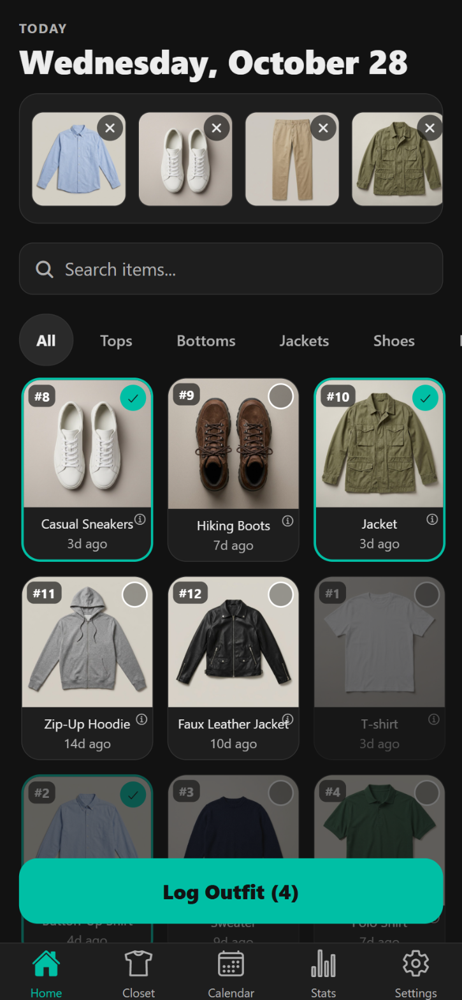
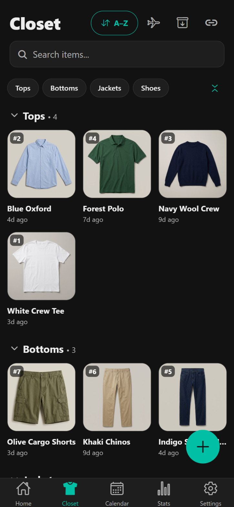
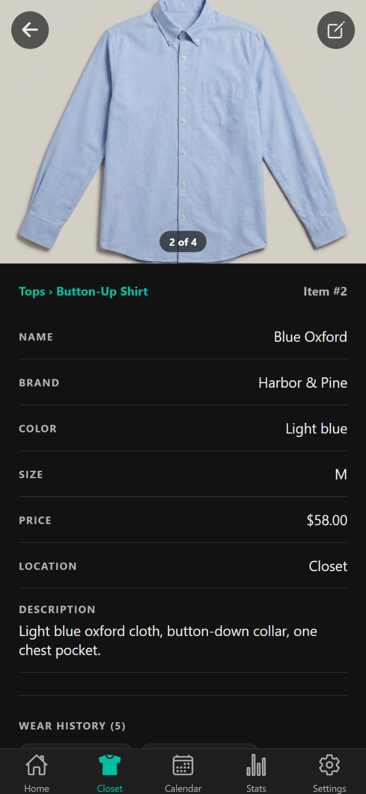
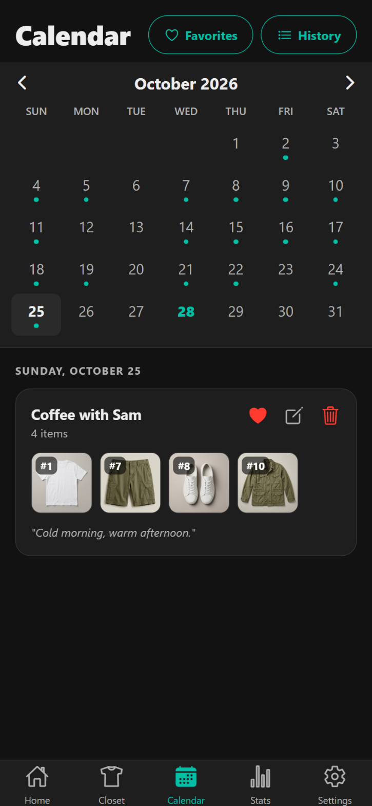
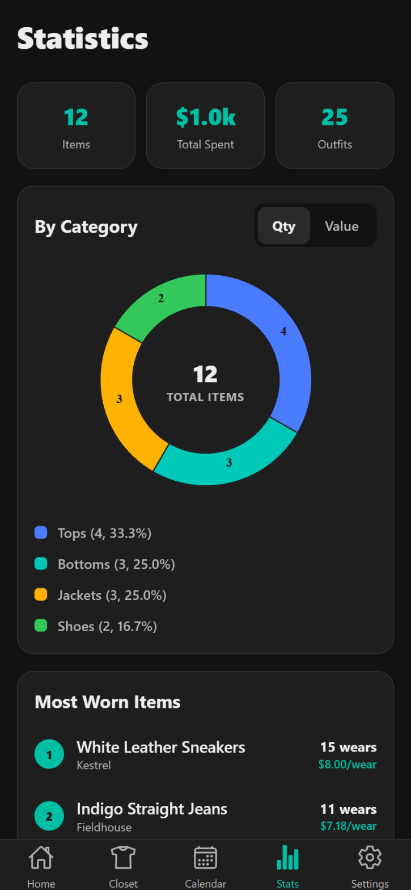
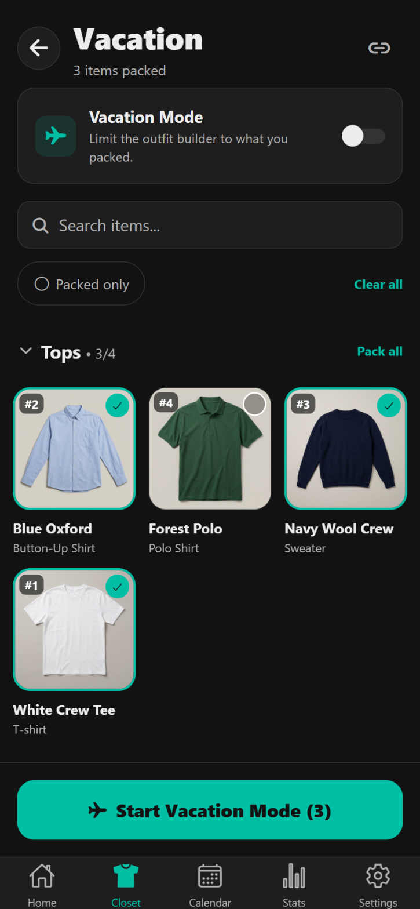

# OOTD

A closet app for the phone. OOTD records the outfit of each day, helps find new combinations, and lets friends send outfit ideas from a shared link.

Built with React Native and Expo. Runs on Android, iOS and the web.

<table>
  <tr>
    <td align="center"><br><sub><b>Home</b>: build an outfit</sub></td>
    <td align="center"><br><sub><b>Closet</b>: items by category</sub></td>
    <td align="center"><br><sub><b>Item</b>: details and wear history</sub></td>
  </tr>
  <tr>
    <td align="center"><br><sub><b>Calendar</b>: outfits by day</sub></td>
    <td align="center"><br><sub><b>Stats</b>: wear counts and value</sub></td>
    <td align="center"><br><sub><b>Vacation</b>: packing list</sub></td>
  </tr>
</table>

## Features

- **Outfit builder.** On Home, a tap on an item adds it to the outfit. The outfit can be logged for today or for a different day.
- **New combinations.** When items are picked, each item that was already worn with all of the picked items turns grey. A warning shows when the same top and bottom were worn together before.
- **Closet.** Items show in groups by category. Each item has a stable number (`#1`, `#2`, ...). The search finds items by name, brand or number. A long press starts a selection, and the selected items can be edited or deleted together.
- **Item details.** Brand, colour, size, price, season and location. A tap on the photo opens it full screen, with pinch and double-tap zoom. Each date in the wear history opens that day in the Calendar.
- **Calendar.** A dot marks each day with an outfit. A tap on a day shows the outfit, which can be edited, moved to a different day, or marked as a favorite.
- **Stats.** Charts of the closet by category or brand, by count or by value. Lists of the most worn items, the cost per wear, and the items that are worn least.
- **Vacation mode.** A packing list for a trip. While vacation mode is on, the outfit builder shows only the packed items.
- **Shared closet.** The app makes a web link to the closet. A friend opens the link in a browser, picks items, and sends an outfit idea. The idea shows on Home, where the owner can accept it. Archived items are not shared.
- **Packing list link.** In vacation mode, a second link shares only the packed items. This link expires after 14 days.
- **Import and export.** Items, photos and past outfits can be imported in bulk. The closet and the outfit history can be exported as text or JSON.

## How it works

All closet data stays on the phone. The app needs no account and no network connection. Only the share feature uses a backend: the app sends a copy of the shared items to Supabase, and friends open it in a small web viewer. The database rules let only a person with the link read a closet, and let only the phone that made the link read the suggestions.

[ARCHITECTURE.md](ARCHITECTURE.md) describes the app, the backend, the web viewer, and the share flow in detail.

## Tech stack

| Part | Tools |
| --- | --- |
| App | React Native 0.86, Expo SDK 57, TypeScript |
| Navigation | React Navigation (bottom tabs and native stack) |
| State | zustand with AsyncStorage |
| Gestures | react-native-gesture-handler, react-native-reanimated |
| Share backend | Supabase (Postgres, row level security, storage) |
| Web viewer | React 19, Vite, Vercel |

## Getting started

Requirements: Node.js and npm.

```bash
npm install
npm start
```

Press `w` to open the app in a web browser, or scan the QR code with the Expo Go app on a phone.

[usage.md](usage.md) explains how to import a closet, how item numbers work, and how to build an APK or an iOS app with EAS.

## Test the shared closet locally

1. Start the app with `npm start`.
2. In a second terminal, start the web viewer:

   ```bash
   cd web
   npm install
   npm run dev
   ```

3. In the app, open the **Closet** tab, tap the link icon in the header, and tap **Create Link**.
4. Copy the token at the end of the link, and open `http://localhost:5173/closet/<token>`.
5. Pick some items in the viewer and send the outfit.
6. In the app, tap the bell icon on Home and accept the outfit.

To make sure that the photos of a link can be downloaded, run:

```bash
node scripts/verify-closet-image.mjs <token>
```

The script reads the closet from Supabase and saves its first photo in `./tmp/`.

To test the access rules of the shared data, run:

```bash
node scripts/verify-share-access.mjs
```

## Project layout

```
App.js                 Navigation and the app root
src/screens/           One file for each screen
src/components/        Parts that more than one screen uses
src/store/             zustand stores: closet and outfits, share sheet, toasts
src/utils/             Outfit rules, import parsers, photo storage, Supabase sync
src/theme.ts           Colours, corner radii and type sizes
web/                   Web viewer for shared closets
supabase/migrations/   Database tables and access rules for sharing
scripts/               Test scripts and the icon generator
docs/screenshots/      Pictures for this file
```

## More documents

- [ARCHITECTURE.md](ARCHITECTURE.md): the parts of the system and how they connect.
- [usage.md](usage.md): the user guide.
- [web/README.md](web/README.md): the web viewer.
